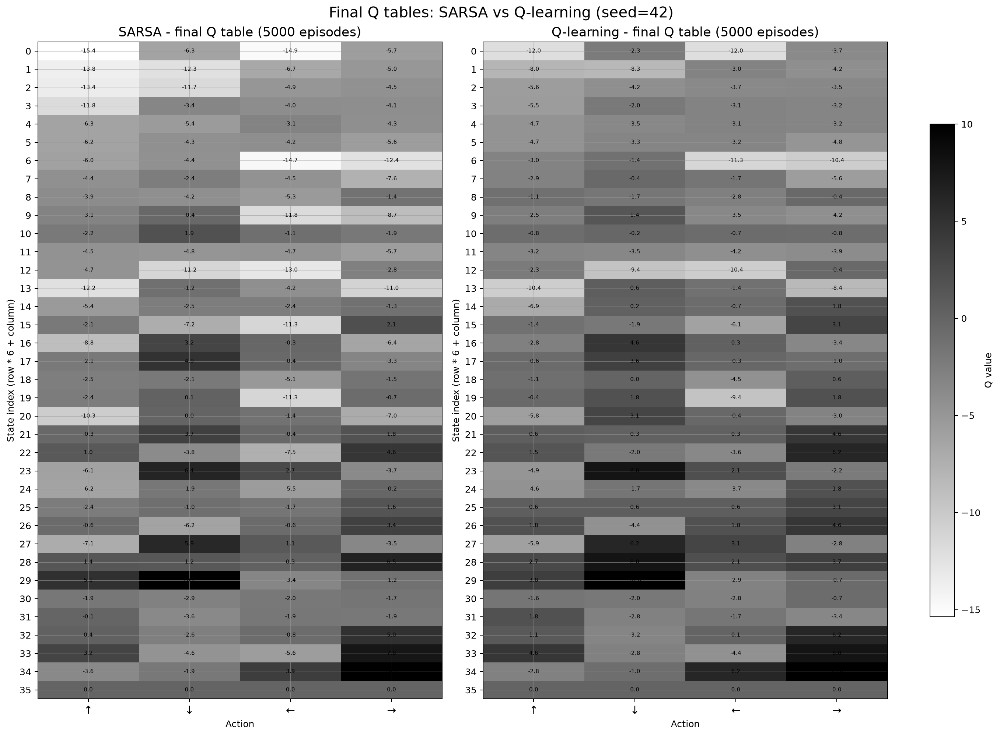

# Q-Learning vs SARSA

Bu proje, aynı 6 × 6 GridWorld ortamında **Q-learning** ve **SARSA** algoritmalarını eğitir ve sonuçlarını karşılaştırır. Eğitim sonunda her iki algoritmanın Q tablosu ve bu tablolardan elde edilen greedy politika terminale yazdırılır; ayrıca eğitim boyunca Q tablolarının değişimini gösteren bir animasyon açılır.

## Son eğitim Q tabloları

Aşağıdaki görsel, 42 rastgelelik tohumu (`seed=42`) ile 5000 bölüm eğitimden sonra elde edilen Q tablolarını gösterir:



Tablolarda her satır bir durumu, sütunlar ise sırasıyla **yukarı, aşağı, sol ve sağ** eylemlerini temsil eder. Durum indeksi `satır × 6 + sütun` biçiminde hesaplanır. Hücrelerdeki değerler, ilgili durum-eylem çiftinin öğrenilmiş Q değerleridir.

## Ortam ve ödüller

- Izgara boyutu: **6 × 6**
- Başlangıç: **(0, 0)**
- Hedef: **(5, 5)**
- Engeller: `(1, 1)`, `(1, 2)`, `(2, 2)`, `(3, 3)`, `(4, 4)`, `(2, 5)`, `(5, 2)`, `(1, 4)`, `(3, 0)`
- Normal bir adım: **−1**
- Hedefe ulaşma: **+10**
- Izgara dışına çıkmayı deneme: **−10** (ajan bulunduğu karede kalır)
- Engelli kareye girme: **−10** (ajan bu kareye girer)

## Algoritmalar

Her iki algoritma da eylem seçimi için **ε-greedy** politika kullanır. Kodda `ε = 0.1` olduğundan ajan çoğunlukla mevcut en iyi eylemi seçer, ancak keşif amacıyla zaman zaman rastgele bir eylem dener.

- **SARSA (on-policy):** Bir sonraki durumdaki, politikanın gerçekten seçtiği eylemin Q değeriyle güncellenir:  
  `Q(s,a) ← Q(s,a) + α [r + γ Q(s',a') − Q(s,a)]`
- **Q-learning (off-policy):** Bir sonraki durum için mümkün olan en yüksek Q değerini kullanır:  
  `Q(s,a) ← Q(s,a) + α [r + γ maxₐ' Q(s',a') − Q(s,a)]`

Hedef durum için güncelleme hedefi doğrudan alınan ödüldür. Öğrenme oranı `α = 0.1`, indirim katsayısı `γ = 0.9` ve eğitim uzunluğu algoritma başına **5000 bölüm** olarak ayarlanmıştır.

## Gereksinimler ve çalıştırma

Python 3 ve `numpy`, `matplotlib` paketleri gerekir:

```bash
python -m pip install numpy matplotlib
python gridworld.py
```

Program önce her algoritma için son Q tablosunu ve greedy politikayı terminale yazdırır, ardından eğitim sırasında kaydedilen Q tablolarını karşılaştıran bir animasyon penceresi açar. Pencereyi kapatmak için grafik penceresini kapatın.

## Proje dosyaları

- [`gridworld.py`](gridworld.py): GridWorld ortamı, SARSA ve Q-learning eğitimi, politika çıktısı ve animasyon.
- [`images/q-tables.png`](images/q-tables.png): Son eğitim Q tablolarının karşılaştırmalı görseli.
